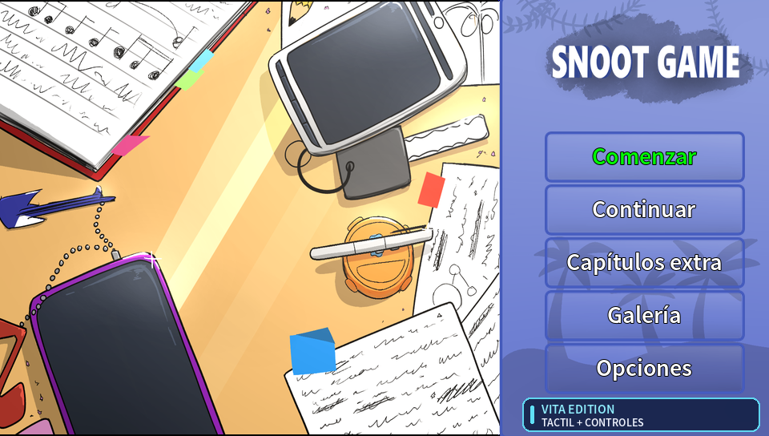
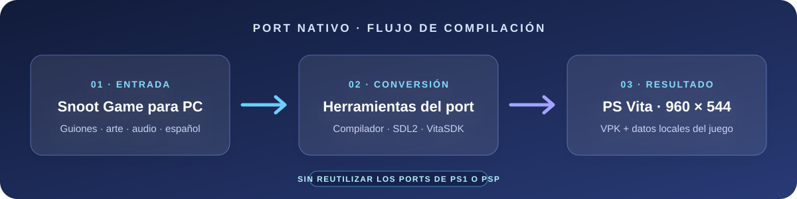

<div align="center">

# Snoot Game para PS Vita

**Port nativo en español · Hecho por Pako Tako**


Port creado a partir del código fuente original de PC, con intérprete nativo y recursos generados para Vita.

</div>

---

## Así se ve

<p align="center">
  
  <br><em>Menú principal adaptado a la pantalla de PS Vita.</em>
</p>

## Un port nativo desde el juego original

El proyecto compila los guiones y convierte arte y audio desde los archivos originales de Snoot Game para PC.
El runtime está escrito en C y usa SDL2 con VitaSDK. El juego conserva su presentación original y añade entrada
por controles y pantalla táctil.

<p align="center">
  
</p>

> **Proyecto de fans no oficial.** No está afiliado con Cavemanon ni Sony. El repositorio no incluye el juego
> original, sus recursos ni un VPK listo para distribuir.

## Qué incluye

- Runtime nativo para PS Vita, compilado como `snoot.vpk`.
- Menú y recursos de interfaz en español a 960 × 544.
- Controles físicos y pantalla táctil.
- Generación local de guiones, imágenes, fuentes y audio desde la copia original del juego.
- Contenido opcional configurado como activado (`persistent.lewd`).

## Compilar

### Requisitos

- Windows 10/11, PowerShell, Git y Python 3.12.
- Docker Desktop iniciado.
- `ffmpeg` y `ffprobe` disponibles en `PATH`.
- Copia legal del juego para PC, extraída en `E:\snoot\snootgame\game`.

VitaSDK y SDL2 se preparan dentro de la imagen Docker fijada por el script.

### Crear el VPK y los datos

Ejecuta desde la raíz del repositorio:

```powershell
py -3.12 -m venv .venv
.\.venv\Scripts\python.exe -m pip install -r requirements.txt
.\.venv\Scripts\python.exe -m tools.snoot_source --game 'E:\snoot\snootgame\game' --out build/vita-source --profile vita
.\.venv\Scripts\python.exe platforms/vita/build.py --profile vita
```

Los archivos se generan aquí:

| Salida | Contenido |
| --- | --- |
| `build/vita/snoot.vpk` | Aplicación para Vita |
| `build/vita-source/DATA/` | Guiones, imágenes, fuentes y audio generados localmente |

La primera compilación descarga SDL2 dentro de `build/vita/` y puede tardar más.

## Instalar

1. Instala `build/vita/snoot.vpk` con VitaShell o Vita3K.
2. Crea `ux0:data/snoot/` en la consola.
3. Copia **el contenido** de `build/vita-source/DATA/` a `ux0:data/snoot/`, conservando los nombres.
4. Inicia el juego. Los guardados se almacenan en `ux0:data/snoot/save/`.

En Vita3K, usa la carpeta de datos equivalente del usuario y conserva la misma estructura `data/snoot/`.

## Estado del port

La estructura del repositorio permite generar los recursos y compilar el VPK. La captura muestra el menú; todavía
se necesita validar una partida completa y el rendimiento en una PS Vita física. Una compilación exitosa por sí
sola no confirma compatibilidad total.

## Estructura del repositorio

```text
engine/                 Intérprete y runtime
games/snoot/            Textos y lógica del juego
platforms/vita/         Compilación y empaquetado VPK
platforms/sdl/          Backend SDL2
tools/snoot_source/     Conversión desde los archivos originales
tools/profile/          Recursos y menú Vita
docs/                   Guías, licencias e imágenes
```

Consulta la [guía de compilación para Vita](docs/platforms/vita.md), la [procedencia del código](tools/snoot_source/PROVENANCE.md)
y las [notas de licencias](docs/licencias.md) antes de redistribuir builds o recursos.

## Créditos

Snoot Game fue creado por Cavemanon y sus colaboradores. Este port fue realizado por **Pako Tako**. El juego y
sus recursos conservan los avisos y licencias incluidos en la distribución original.
